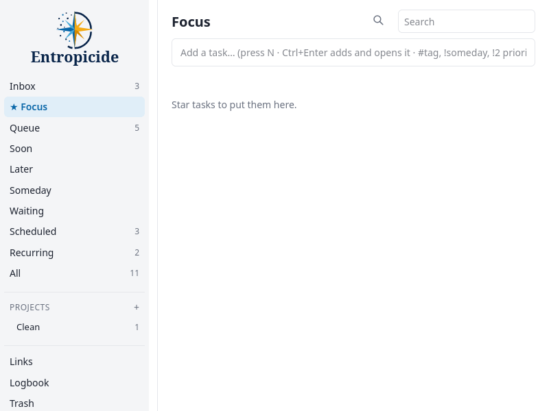

# Entropicide

*From chaos to clarity.* Entropicide is a self-hosted task manager for
[Getting Things Done](https://gettingthingsdone.com/) (GTD), in the spirit of NirvanaHQ: an
Inbox to capture everything, a Queue of next actions, Focus for today, projects, areas, tags,
repeating tasks and reminders, for you, your family or a small team.



- **Capture fast:** quick add reads `Call dentist tomorrow 3pm #phone !next +home`; share pages,
  photos and files from your phone; add tasks from an Android notification without leaving the
  app you're in.
- **Plan:** projects (sequential or not), areas, tags, priorities, dependencies ("blocked by"),
  repeating tasks, project templates, expiry dates and a focus timer.
- **Stay on it:** push reminders with ✓ Done and Snooze, a morning summary, quiet hours, and
  two-way Google Calendar sync.
- **Anywhere:** works in any browser, installs as an app (an Android app too), and keeps working
  offline, sending changes when the connection is back.
- **Yours:** one small server, one SQLite file, nightly backups, and an export of everything.
  Accounts are invite-only and each user's tasks are private.

The in-app **Help** page (press `?`) explains every feature with examples; there's also a
[feature tour](docs/features.md).

## Running it

The usual way is the container image with Docker Compose, behind a web server that provides
HTTPS (Caddy, nginx, Traefik…).

1. Make a folder and save [`docker-compose.yml`](docker-compose.yml) in it. Replace `OWNER` in
   the image name, and set `ENTROPICIDE_PUBLIC_URL` (the address people will open) and `TZ`.
2. Start it, and make your account:

   ```sh
   docker compose up -d
   docker compose exec entropicide manage create-user YOURNAME --admin
   ```

3. Point your web server at `127.0.0.1:8000` (examples below), and sign in. Add other people
   from **Settings → Users**.

Everything it keeps (the database, nightly backups in `data/backups`, and its secret key) is in
the `data` folder next to `docker-compose.yml`: back that folder up.

**Updating:** `docker compose pull && docker compose up -d`. The database is upgraded in place.

### Web server examples

Caddy (gets the HTTPS certificate itself):

```
tasks.example.com {
    reverse_proxy 127.0.0.1:8000
}
```

nginx (with a certificate from certbot or similar):

```nginx
server {
    listen 443 ssl;
    server_name tasks.example.com;
    # ssl_certificate ...; ssl_certificate_key ...;
    client_max_body_size 30m;   # attachments are up to 25 MB
    location / {
        proxy_pass http://127.0.0.1:8000;
        proxy_set_header Host $host;
        proxy_set_header X-Forwarded-For $proxy_add_x_forwarded_for;
        proxy_set_header X-Forwarded-Proto $scheme;
        proxy_set_header X-Forwarded-Host $host;
    }
}
```

To serve it under a path rather than a whole site (`https://example.com/tasks/`), set
`SCRIPT_NAME: /tasks` in `docker-compose.yml` and forward `/tasks` unchanged (in nginx:
`location /tasks { proxy_pass http://127.0.0.1:8000; ... }`).

### Without Docker

On a Linux server with Apache and systemd, `deploy/install.sh` installs it in
`/opt/entropicide` as a service, with nightly backups: see
[docs/install-apache.md](docs/install-apache.md). Anywhere else, it's a standard Python web
app: `pip install -r requirements.txt`, then run `gunicorn --workers 1 --threads 4 app:app` with
the settings below, behind a web server. Node.js is needed for tasks added from the Android app.

## Settings

Set as environment variables (in `docker-compose.yml`, or `.env` for `install.sh`). Only the
first is needed.

| Setting | What it does |
|---|---|
| `ENTROPICIDE_PUBLIC_URL` | The address people open, e.g. `https://tasks.example.com/`. Used in notifications, exports and calendar events. |
| `SCRIPT_NAME` | The path it's served under, if not a whole site, e.g. `/tasks`. |
| `TZ` | The server's time zone. Each user's own comes from their browser. |
| `ENTROPICIDE_DATABASE` | The SQLite file (`/data/entropicide.db` in the container). |
| `ENTROPICIDE_BACKUP_DIR` | Where backups go (default: `backups` beside the data folder). |
| `ENTROPICIDE_SECRET_KEY` | Signs sign-in cookies. If unset, one is made and kept in `secret_key` beside the database. |
| `ENTROPICIDE_SECURE_COOKIES` | `0` to allow sign-in over plain HTTP (testing only). |
| `ENTROPICIDE_OPERATOR`, `ENTROPICIDE_CONTACT` | Who runs the site, and an email or web address for questions, shown on the privacy page. |
| `ENTROPICIDE_GOOGLE_CLIENT_ID`, `ENTROPICIDE_GOOGLE_CLIENT_SECRET` | Turn on Google Calendar sync: see [docs/google-calendar.md](docs/google-calendar.md). |
| `ENTROPICIDE_ANDROID_PACKAGE`, `ENTROPICIDE_APK_DIR` | Your own Android app, if you build one: see [docs/android.md](docs/android.md). |

**Optional features turn on by themselves:** push notifications work once the site is on HTTPS
(the server makes its own signing key, `vapid_private.pem` in the data folder); Google Calendar
once its client is set; the Android download once an APK is in the APK folder.

## Backups

The whole database (attachments included) is one SQLite file. Every night a consistent copy is
saved as `backups/entropicide-YYYY-MM-DD.db.gz`, keeping the last 7 days, 4 Sundays and 12
firsts of the month. Admins can also download a full backup from **Settings → Backups**, and
everyone can download their own data (JSON, CSV and files) from **Settings → Your data**.

```sh
docker compose exec entropicide manage list-backups
docker compose exec entropicide manage backup              # one now
docker compose stop entropicide                            # restore: stop it first,
docker compose run --rm entropicide manage restore /data/backups/entropicide-2026-10-28.db.gz
docker compose start entropicide
```

A restore checks the file first and saves the data from just before it
(`entropicide-before-restore-….db.gz`), so it can be undone the same way.

## Users

```sh
docker compose exec entropicide manage list-users
docker compose exec entropicide manage create-user NAME [--admin]
docker compose exec entropicide manage set-password NAME
```

Admins can also add, disable and reset users from **Settings → Users**.

## Developing

Flask and SQLite on the server (`app.py`, `db.py`); plain JavaScript in the browser
(`static/app.js`, with quick add's parser in `static/quickadd.js`), with no build step.

```sh
python3 -m venv venv && venv/bin/pip install -r requirements.txt -r requirements-dev.txt
venv/bin/python manage.py create-user me --admin      # uses ./data/entropicide.db
ENTROPICIDE_SECURE_COOKIES=0 venv/bin/gunicorn --bind 127.0.0.1:5003 app:app
# open http://127.0.0.1:5003/
venv/bin/python -m pytest                             # the tests (tests/)
```

See [CONTRIBUTING.md](CONTRIBUTING.md) for how changes are made, and
[SECURITY.md](SECURITY.md) to report a vulnerability.

## License

Entropicide is free software under the [GNU Affero General Public License v3.0](LICENSE): you
can use, change and share it, and if you run a changed version for others to use over a
network, you must offer them its source code.

The name **Entropicide**, its logo and the compass symbol are trademarks and are not covered
by the license: see [TRADEMARKS.md](TRADEMARKS.md). Bundled libraries keep their own licenses:
pdf.js (Apache-2.0, `static/vendor/pdfjs`) and CodeMirror (MIT, `static/vendor/codemirror`).
